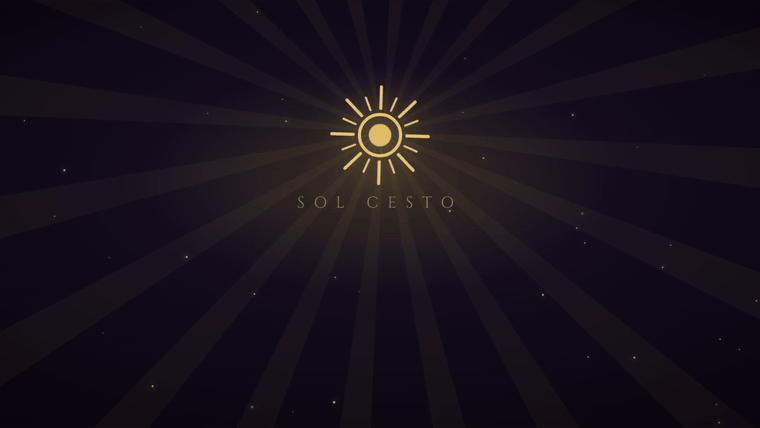
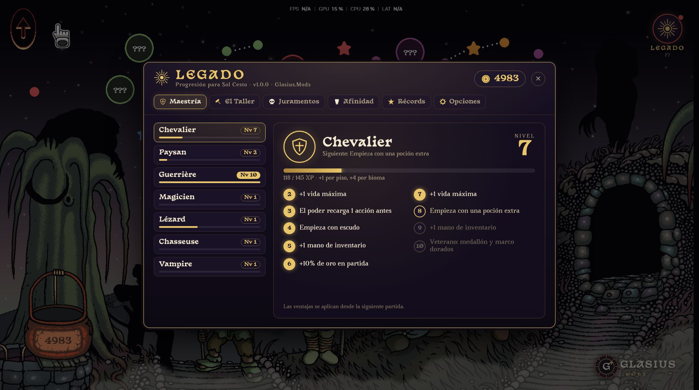
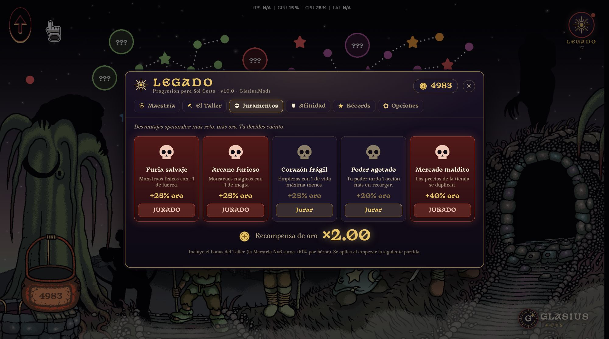
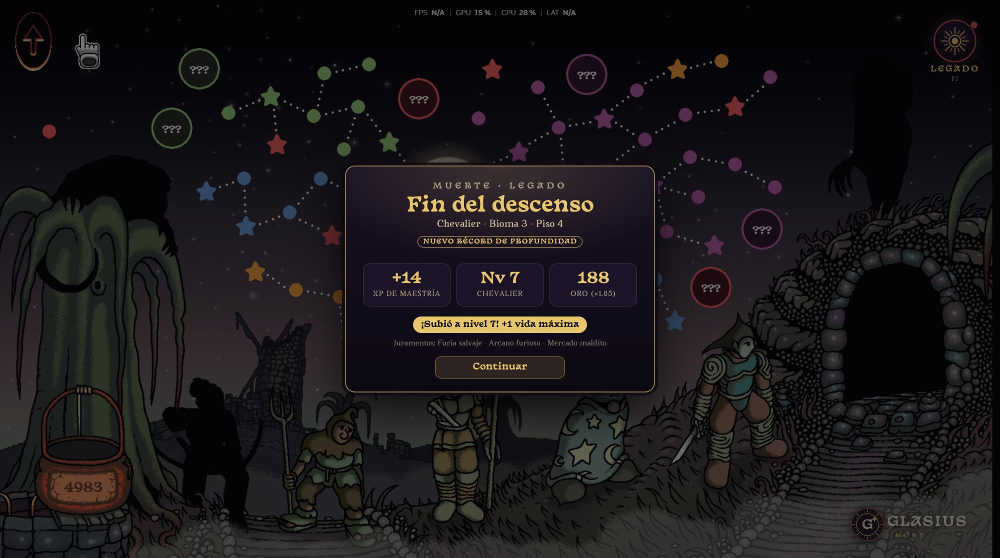
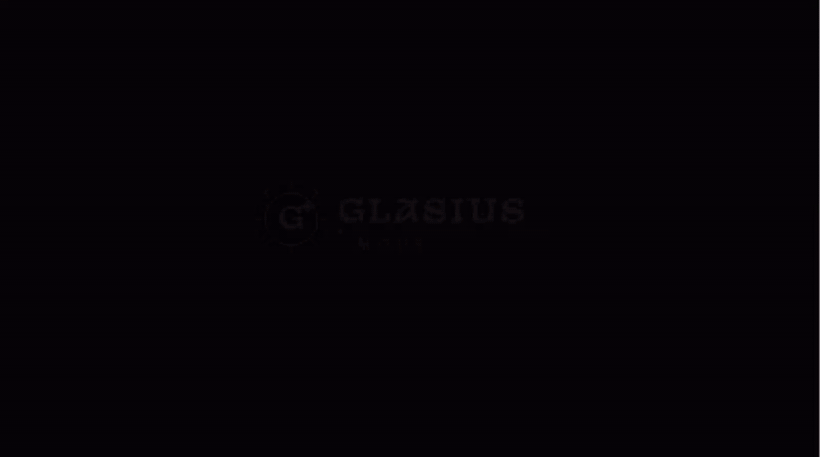

  

<h1 align="center">LEGADO — Progresión para Sol Cesto</h1>

  <b>Mod no oficial</b> que añade progresión entre partidas a <a href="https://store.steampowered.com/app/2738490/Sol_Cesto/">Sol Cesto</a> sin quitarle el reto. 
  <i>Unofficial progression mod for Sol Cesto — English summary below.</i>

  
  
  

  

---

## ¿Qué añade?

| | |
|---|---|
| **Maestría de héroes** — cada héroe sube hasta el nivel 10 jugando: vida, recarga del poder, objetos iniciales, +2 manos de inventario y el título de Veterano. |  |
| **Juramentos** — 5 desventajas opcionales (monstruos más fuertes, menos vida, tienda cara…). Cuantas más aceptes, más oro ganas. |  |
| **Récords y resumen** — historial de partidas, mejores profundidades por héroe y un resumen al terminar cada partida. |  |

También incluye:
- **El Taller**: mejoras permanentes compradas con tu oro permanente.
- **Afinidad de dientes**: los dientes que más eliges aparecen más seguido (sin volverse más fuertes).
- **Opciones**: activa o desactiva cada sistema; exporta, importa o reinicia tu progreso.

Todo se abre con **F7** o con el medallón **LEGADO** del menú principal:

  

## Instalación (1 minuto)

1. Descarga `Legado-vX.Y.Z.zip` desde [Releases](https://github.com/GlasiusExe/Legado-SolCesto/releases/latest) y **descomprímelo**.
2. **Cierra** Sol Cesto.
3. Doble clic en **`INSTALAR.bat`**. Encuentra el juego solo en tus bibliotecas de Steam.
4. Abre el juego y pulsa **F7**.

> Si Windows muestra *"Windows protegió su PC"*: **Más información → Ejecutar de todas formas**. Es normal en scripts descargados de internet; el código es abierto y puedes revisarlo en `instalador/legado-installer.ps1`.

**Desinstalar:** doble clic en `DESINSTALAR.bat`. El juego vuelve a ser el original.

**Después de una actualización de Steam:** el mod se desactiva solo; vuelve a ejecutar `INSTALAR.bat`.

## Preguntas frecuentes

- **¿Afecta mi partida guardada?** No borra nada del juego. El progreso del mod se guarda aparte y el oro que gastas en el Taller se descuenta de tu oro permanente.
- **¿Puedo jugar "puro" otra vez?** Sí: desactiva los sistemas en *Opciones* o usa `DESINSTALAR.bat`.
- **¿Funciona en Steam Deck / Linux?** Por ahora el instalador es solo para Windows.
- **¿Incluye archivos del juego?** No. El instalador modifica tu copia instalada y guarda un respaldo en `package.nw.original`.

## English

**Legado** adds meta-progression to Sol Cesto: hero mastery (10 levels), a permanent-gold workshop, optional oaths (harder runs, more gold), tooth affinity, records and an end-of-run summary.
**Install:** download the release ZIP, unzip, close the game, double-click `INSTALAR.bat`, then press **F7** in game. **Uninstall:** `DESINSTALAR.bat`.

## Créditos

Hecho por **Glasius.Mods**. Sol Cesto pertenece a **Tambouille** y **Goblinz Publishing**; este proyecto no está afiliado a ellos.
El código se publica bajo licencia [MIT](LICENSE).
